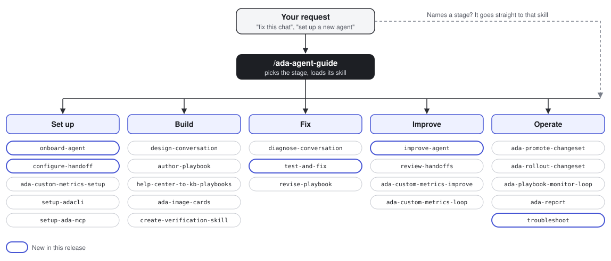

# Ada Agent Skills

**Start here: `/ada-agent-guide`.** Describe what you want in your own words.
The guide picks the right skill, so you do not need to remember the skills.



| Stage | Skills the guide sends you to |
|---|---|
| Set up | `onboard-agent`, `configure-handoff`, `ada-custom-metrics-setup`, `setup-adacli`, `setup-ada-mcp` |
| Build | `design-conversation`, `author-playbook`, `help-center-to-kb-playbooks`, `ada-image-cards`, `create-verification-skill` |
| Fix | `diagnose-conversation`, `test-and-fix`, `revise-playbook` |
| Improve | `improve-agent`, `review-handoffs`, `ada-custom-metrics-improve`, `ada-custom-metrics-loop` |
| Operate | `ada-promote-changeset`, `ada-rollout-changeset`, `ada-playbook-monitor-loop`, `ada-report`, `troubleshoot`, `ada-tune-reasoning-level` |

If your request already names a stage or a skill, the guide steps aside and
that skill runs directly.

## About

Skills for designing, building, changing, rolling out and monitoring an Ada AI
Agent. Anyone who can reach their agent through the Ada command line (adacli)
or the Ada MCP server can use them. You do not need Ada Architect.

One repo and one plugin serve both routes. Each skill has a
`references/runtime-cli.md` and a `references/runtime-mcp.md`. Your assistant
reads the one that matches the tools it has, and says plainly what it cannot do
on your route.

## Install

| Assistant | Command or steps |
|---|---|
| Claude Code | `claude plugin marketplace add roystonlee-ada/ada-agent-skills` then `claude plugin install ada-agent-skills@ada-agent-skills` |
| Codex | `codex plugin marketplace add roystonlee-ada/ada-agent-skills` then `codex plugin add ada-agent-skills@ada-agent-skills`. Start a new session afterwards |
| ChatGPT | Upload the plugin folder under Personal plugins, or ask a workspace admin to publish it. See OpenAI's plugin docs |
| Any other assistant that reads Agent Skills | Copy `plugins/ada-agent-skills/skills/` into that assistant's skills folder |

Then ask your assistant to "set up adacli" (command line) or "set up the Ada
MCP" (no shell needed). Each setup skill checks the connection to your
instance.

## Skills

| Skill | Use it to |
|---|---|
| `setup-adacli` | Check adacli, install or upgrade it with Homebrew, log in |
| `setup-ada-mcp` | Connect your assistant to your Ada instance over MCP and check it works |
| `onboard-agent` | Set up a new agent stage by stage. It reads what is done and resumes where you stopped |
| `configure-handoff` | Set up or fix handoff to Zendesk, Salesforce, Gladly, email and other platforms, one link of the chain at a time |
| `test-and-fix` | Run a use case's tests, fix each failure on a changeset, and retest until all pass |
| `improve-agent` | Rank improvements across the agent by how much each moves handoffs, containment, CSAT and custom metrics |
| `troubleshoot` | Answer an Ada platform or account question with steps, downtime risk, rollback and a source |
| `ada-tune-reasoning-level` | Choose which SET and ASK steps run at Reasoning level High, test each on its own inputs, and stage the change |
| `design-conversation` | Design a new use case as sample conversations you approve before anything is built |
| `author-playbook` | Build the approved design into a playbook, save its scenarios as tests, run them |
| `revise-playbook` | Change an existing use case, with today's flow shown beside the proposed one |
| `diagnose-conversation` | Find which part of the agent owns a bad conversation, with evidence |
| `review-handoffs` | Count handoffs by the reason Ada recorded, with samples |
| `ada-promote-changeset` | Check a staged change, show its real diff, and hand you the promote step |
| `ada-rollout-changeset` | Ramp a change onto live traffic in steps or at one percent you choose, and judge it against the baseline |
| `ada-playbook-monitor-loop` | Test a playbook, watch real chats for verified problems, and stage tested fixes |
| `create-verification-skill` | Write a `verify-<subject>` skill that defines "works" for one use case, code tool or number, and re-runs the proof after every change |
| `ada-custom-metrics-setup` | For an agent with no custom metrics: read its chats and topics, use your industry as a guide, interview you where the evidence is thin, and propose a scorecard |
| `ada-custom-metrics-improve` | Review the custom metrics on an agent, separate real defects from a bad judge, rank them by impact, and fix them as a changeset |
| `ada-custom-metrics-loop` | Run the improvement loop on one metric or all of them: measure, fix, ramp, re-measure against a target, and repeat |
| `ada-agent-guide` | Pick the right skill when a request about your agent names no stage, such as "fix this chat" or "get this live" |
| `help-center-to-kb-playbooks` | Turn a help center into KB articles and playbooks, and show screenshots in playbook steps |
| `ada-image-cards` | Show a picture built from live data, such as a status card, in a playbook step |
| `ada-report` | Build a branded report on how your agent performs, from real metrics and conversations |

## What each route can do

| | adacli | Ada MCP |
|---|---|---|
| Read the agent, conversations and metrics | Yes | Yes |
| Stage changes on a changeset | Yes | Yes |
| Save test cases and run them | Yes | Yes, with your confirmation and the daily run quota |
| Start, raise or stop a sampled rollout | Yes | Yes, when you ask for the step. If your permissions refuse it, the skill tells you the dashboard step |
| Promote or revert a changeset | Yes, after your go-ahead | Yes, after your confirmation of a preview. If your permissions refuse it, the skill tells you the dashboard step |

Nothing reaches live customers without you. Edits land on a changeset that is
not live, and you approve every test run, rollout step and promote.

## Before you start

- What you can do depends on your Ada user's permissions.
- Homebrew installs adacli on macOS and Linux. It ships the binary only. The
  skills come from this plugin.
- Some `runtime-cli.md` files also name optional helper scripts from Ada's
  Architect tool. Without them, use the plain adacli commands beside them.
- The ChatGPT and Codex steps follow those products' docs. They have not been
  tried against a live Ada instance yet.

## Update

Claude Code: `claude plugin marketplace update ada-agent-skills`, then
`claude plugin update ada-agent-skills@ada-agent-skills`.
Codex: `codex plugin marketplace upgrade ada-agent-skills`.

How you hear about updates:

- Claude Code tells you at session start when a newer version exists, at most
  once a day. Restart after you update.
- Every version has a [release](https://github.com/roystonlee-ada/ada-agent-skills/releases)
  with notes, also listed in [CHANGELOG.md](CHANGELOG.md). To get an email for
  each one, choose Watch, then Custom, then Releases on this repo.
- Claude Code can also update the marketplace for you at startup. Run
  `/plugin`, open Marketplaces, choose `ada-agent-skills` and turn on auto-update.

## Moving from the old names

This repo was `ada-architect-skills`, and a sibling repo,
`ada-architect-skills-mcp`, held the MCP-only copy. This one plugin replaces
both. Remove the old plugin, then add this marketplace:

```bash
claude plugin uninstall ada-architect-skills@ada-architect
claude plugin uninstall ada-architect-skills-mcp@ada-architect-mcp
```

## Maintainers

Built from Ada's internal Architect skills by `local/build_plugin.py`. Bump
`VERSION` there and add a `CHANGELOG.md` section for every change people should
get, because Claude Code updates a plugin only when its version changes. Every
skill must run over adacli or the Ada MCP without Architect. The build fails if
a customer name, an id or an email is left in a skill.
